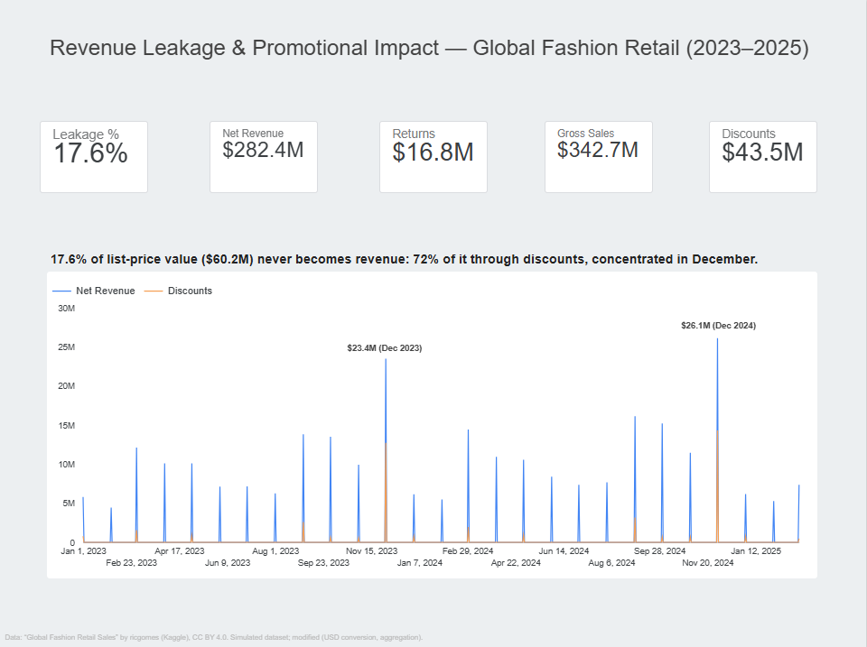
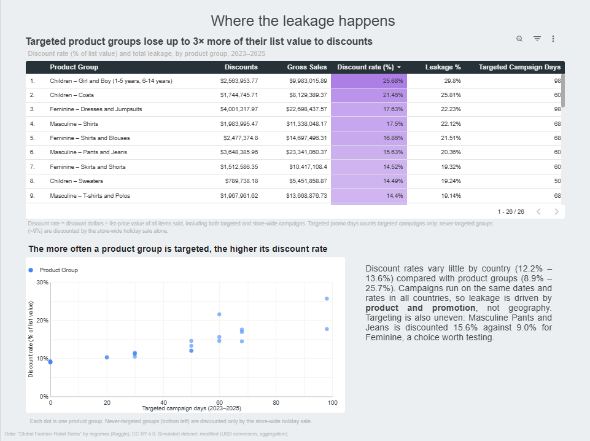
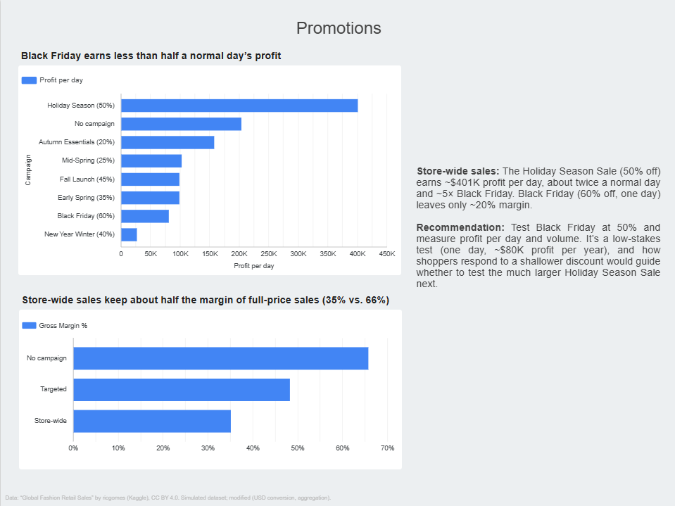

# Revenue Leakage & Promotional Impact Analysis — Global Fashion Retail

**Tools:** Google BigQuery (SQL) · Google Cloud Storage · Looker Studio
**Dashboard:** [View the Looker Studio dashboard](ADD-YOUR-LINK-HERE)

---

## The question

<!-- ✏️ Rewrite in your own words: why you picked this question and what you wanted to find out. -->

How much of a fashion retailer's potential revenue never turns into revenue, where does it go, and are the promotions that cause it worth what they cost?

I framed the analysis around **revenue leakage** (discounts and returns) and **promotional impact**, the kind of questions a revenue-management or commercial analytics team works on.

---

## Headline

**17.6% of list-price value ($60.2M) never becomes revenue.** About 72% of that is discounts, and **65% of all discount dollars are given away in roughly 13 store-wide sale days a year.** Within those days, the two sales perform very differently: the Holiday Season Sale earns about **2× a normal day's profit**, while Black Friday earns **less than half**.

| | Amount (USD) | Share |
|---|---|---|
| Gross sales (list price) | $342.7M | |
| − Discounts | $43.5M | 12.7% of gross |
| − Returns refunded | $16.8M | 5.6% of net sales |
| **= Net revenue** | **$282.4M** | |
| **Total leakage** | **$60.2M** | **17.6% of gross** |

---

## Key findings

### 1. Leakage is driven by product and promotion, not geography
- Discount rates vary little by country (**12.2% China – 13.6% Germany**) but widely by product group (**8.9% – 25.7%**).
- Campaigns run on the same dates and at the same rates in every country, so country differences come from *what* customers buy, not from different pricing.

### 2. Targeted campaigns explain the gap between product groups
- Product groups that are never targeted sit at a **~9% baseline**, which comes entirely from the store-wide holiday sale.
- The most-targeted groups lose up to **3× more** of their list value to discounts (e.g. Children's Girl & Boy: **25.7%**).
- Targeting is uneven across similar products: **Masculine Pants & Jeans is discounted 15.6% vs. 9.0% for Feminine**, which has no targeted campaigns at all.

### 3. The holiday sale is where most discount money goes
- The promotional calendar is identical every year: five targeted campaigns, plus Black Friday (1 day, 60%) and the Holiday Season Sale (Dec 20–31, 50%).
- Those **~13 store-wide days account for 65% of all discount dollars.**
- Every campaign in the data explains every discount: all campaign sales are discounted, and no sale outside a campaign is.

### 4. Black Friday underperforms
| | Profit per day | Margin |
|---|---|---|
| Holiday Season Sale (50% off) | ~$401K | |
| Normal day (full price) | ~$204K | 65.8% |
| Black Friday (60% off) | ~$81K | |
| Store-wide sales overall | | 35.1% |

- Production cost is ~34% of list price, so 60% off leaves only ~15% margin, and the extra volume doesn't make up for it.

### 5. Other patterns
- **December dominates** (~$23–26M net revenue vs. ~$6–16M other months).
- **Summer (June–August) is the slowest period and has no promotions at all.**
- **2024 net revenue grew ~13%** over 2023, with every month up year over year.
- **Full-price sales are 81% of net sales but 87% of gross profit.**

---

## Recommendation

<!-- ✏️ Rewrite in your own words. -->

**Test Black Friday at 50% off and measure profit per day and volume.**

- It's **low-stakes**: one day a year, ~$80K profit, easy to reverse.
- Each sale would earn ~2.7× the profit (≈ $16 vs. $6 per $100 of list value), so volume could fall by more than half and still break even.
- How shoppers respond to a shallower discount would show whether testing the much larger **Holiday Season Sale** (12 days, ~$9.6M profit) is worthwhile.

I would **keep** the holiday sale. Holiday shoppers are likely to buy elsewhere without it, so its cost can't be judged without a counterfactual.

---

## Decisions & assumptions

<!-- ✏️ These reflect your reasoning during the project. Rewrite each one in your own words. -->

- **Why gross sales are calculated:** the data only has the amount paid and a discount *rate*. Measuring leakage needs the list-price value as a baseline.
- **Returns are measured at the refunded amount**, not list price. Refunds are paid at the discounted price, so the discount on a returned item is reversed rather than double-counted.
- **Return rows are sign-adjusted** (positive quantity, negative amount in the raw data) so they subtract correctly from every total.
- **Currencies converted to USD at fixed average rates.** Percentages within each country aren't affected by the rate choice.
- **Production cost is assumed to be in USD.** The resulting 66% full-price margin is plausible for fashion retail, which supports the assumption.
- **Only campaigns overlapping the sales period were analysed.** The campaign calendar starts in 2020, but sales only cover Jan 2023 – Mar 2025.
- **Returns are not tagged to campaigns:** the campaign running on a return date says nothing about how the item was bought.
- **The holiday sale's value can't be judged from this data alone.** Every holiday season in the data has a sale, so there's no comparison without one.
- **November is lower than October** because October has a 10-day campaign and November has only one promotion day. I chose this simpler explanation over customers "waiting" for Black Friday.
- **Profit per day is only compared like-for-like:** store-wide sales against normal days, targeted campaigns against each other.

---

## Data limitations

- **The dataset is synthetic.** Several results look too clean to be real:
  - returns are a flat ~5.6% in every country and product group
  - normal daily volume is nearly identical across product groups
  - campaign volume lifts reach up to 11× normal
  - production cost is a near-constant 32–35% of list price
  - Black Friday falls on Nov 27 in both years

  The **methods** carry over to real data; the **magnitudes** shouldn't be taken as real-world evidence.
- **The Black Friday finding rests on only two days.**
- **No inventory data**, so stock levels can't be tested as an explanation.
- **No supplier-funded discounts or basket data**, both of which can change margin in real retail.

---

## Further questions

- **Do targeted campaigns pay off?** Targeted sales keep less margin than full price (48% vs. 66%), so they need enough extra volume. The simulated lifts are too large to answer this reliably; a controlled store-level test would.
- **Is uneven targeting a missed opportunity or protected margin?** For example, testing a campaign on Feminine Pants & Jeans in some stores.
- **Would a summer sale fill the June–August gap?**
- **Why is the New Year Winter Sale so weak** (~$27K/day vs. $99–158K for other targeted campaigns)? Thinner margins are ruled out (cost is 33.6–35.1% of list, like everything else). That leaves post-holiday fatigue or low leftover winter stock, which would need inventory data.

---

## How it was built

1. **Loaded** six CSV tables (6.4M transaction lines) into BigQuery via a Cloud Storage bucket.
2. **Validated** the data: row counts, how returns and currencies are recorded, and that totals reconcile.
3. **`v_sales` view:** joins transactions to products and stores, renames columns, converts to USD, and adds gross / discount / net / cost fields.
4. **`v_sales_promo` view:** tags each sale with its campaign using a date-range join, checked for overlaps (none) and against the data's own discount column (100% match).
5. **Analysis queries:** leakage by country, product group, campaign type and month; campaign calendar; lift; margin; profit per day.
6. **`dash_daily` summary table:** pre-aggregated data for the dashboard, so charts don't re-scan 6.4M rows.
7. **Looker Studio dashboard:** three pages (Overview, Where it leaks, Promotions).

**SQL techniques used:** joins (including a date-range join), CTEs, conditional aggregation (`SUM(IF(...))`), `CASE`, window functions, `HAVING`, scalar subqueries, `INFORMATION_SCHEMA`, views and summary tables.

## Repository contents

| File | Contents |
|---|---|
| `fashion_retail_analysis.sql` | All queries in the order they were run, with results and findings as comments |
| `screenshots/` | Dashboard pages |
| `README.md` | This file |

---

## About this project

<!-- ✏️ Write this yourself. Suggested points: why you built it, that you used AI assistance for parts of the SQL, how you validated and interpreted the results, and which queries you wrote yourself. -->

---

## Data source

*Global Fashion Retail Sales* by ricgomes, Kaggle (https://www.kaggle.com/datasets/ricgomes/global-fashion-retail-stores-dataset), licensed under [CC BY 4.0](https://creativecommons.org/licenses/by/4.0/). Described by its author as a sales simulation for two years of a multinational brand: the data is **synthetic** and does not represent a real company.

**Changes made:** amounts converted to USD at average exchange rates; tables joined and aggregated; returns sign-adjusted; country names translated to English; derived fields added (gross, discount, margin, campaign tagging). Full details are in the SQL file.
